# Phnom Penh Digital World · ពិភពឌីជីថលភ្នំពេញ

A multiplayer 3D city, marketplace, transport and delivery platform built on **real Phnom Penh
map data**. This repository grew out of two existing projects, which are left untouched:

* **CampusEats World** (`~/Downloads/campuseats-world`): the SvelteKit + Three.js 3D
  shopping game with 29 Blender GLBs. Its engine pieces (asset loading, articulated character
  animation) are reused, and the food court still runs at **`/mall`**.
* **CampusEats** (`~/Desktop/campusEats`): the FastAPI + PostgreSQL ordering backend. Its
  core (config, Argon2 auth, CSRF, error envelope, rate limiting, Alembic, real-DB tests) is
  reused. Its canteen ordering and demo-payment code are the reference for Phases 4 and 7.

**Status: Phases 1 (Foundation), 2 (3D city), 3 (Multiplayer), 4 (Marketplace) and 5
(Transportation) are complete.** A new user can register, verify, build an avatar, choose roles, pick a private
delivery address and a public spawn area on a real map, then walk the real streets of Daun Penh
in 3D with other real players (chat, emotes, friends, invites, moderation). **Sellers** apply
with their business details, are approved by an administrator, claim one of 1,680 virtual shop
units cut into real street frontages, and stock it from a dashboard. **Buyers** walk through the
shop's doorway, pick a product off the shelf (it appears in their hand), drop it in the shop's
cart and pay at the counter with a clearly labelled **demo** checkout; the seller fulfils the
order. Players take a free **bicycle or motorbike**, ride it on the real streets (the server
checks every move at that vehicle's speed and keeps it on roads it may use), get directions on a
routing graph built from the OSM road network (one-way streets respected, right-hand lane), let
the autopilot ride the route, and park at the kerb; other players see riders and parked vehicles.
Delivery and the demo wallet come next (`docs/ROADMAP.md`).

| | |
|---|---|
| 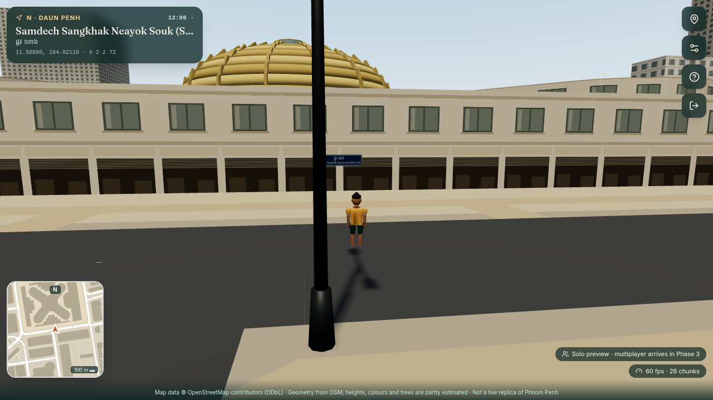 | 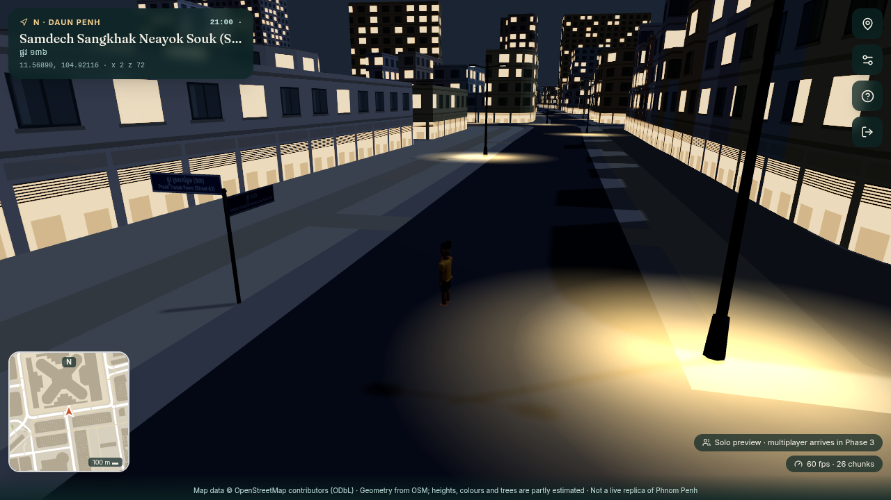 |
| 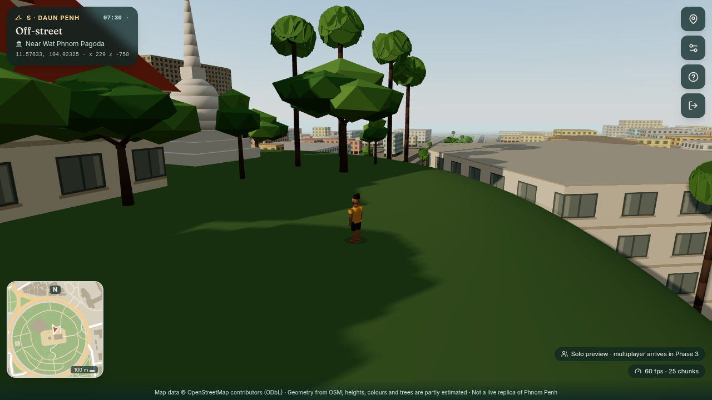 | 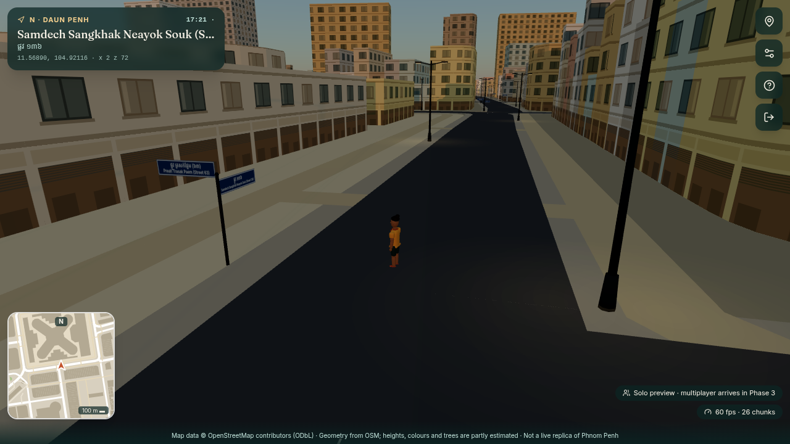 |
| 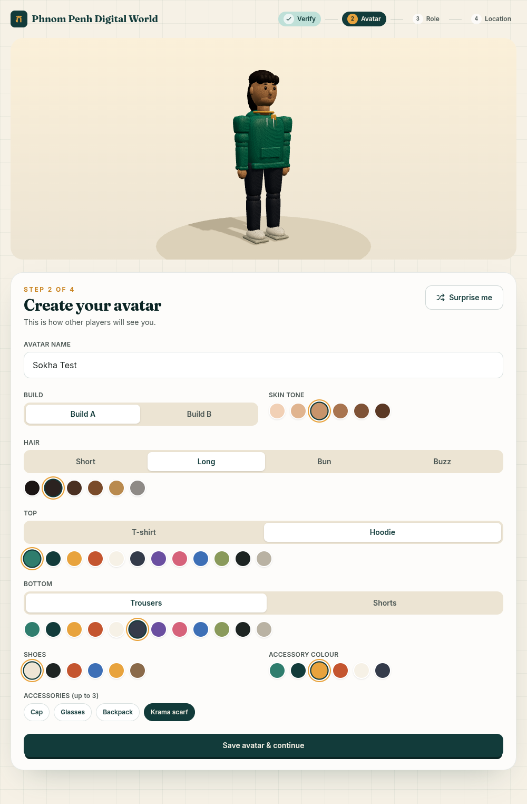 | 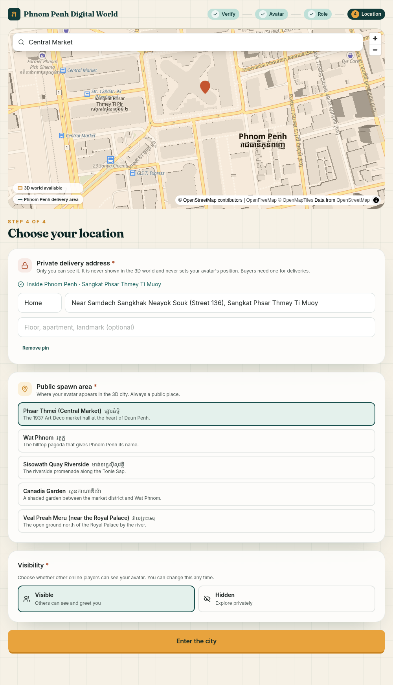 |
| 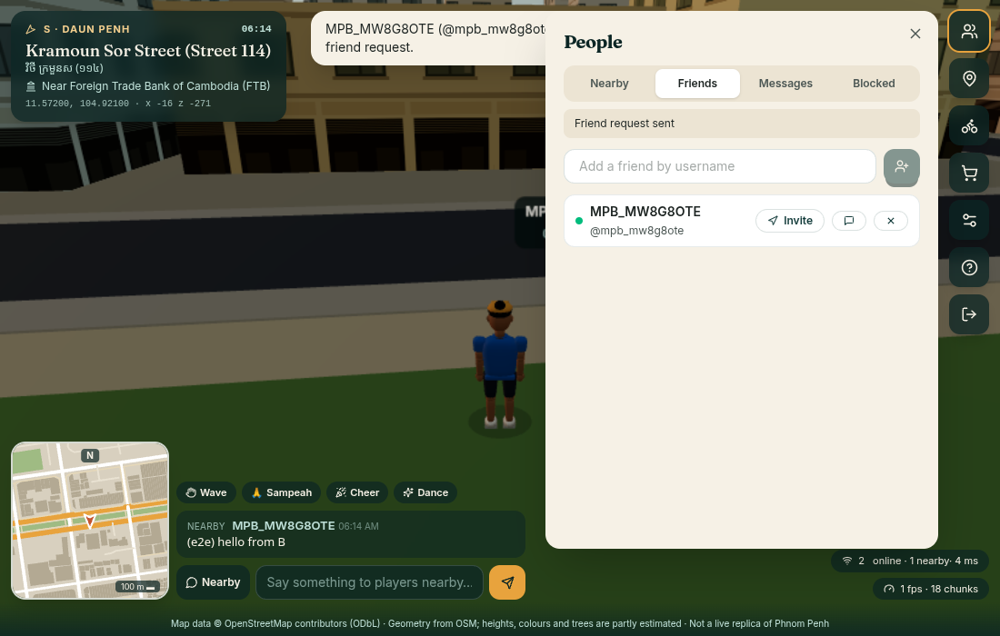 | 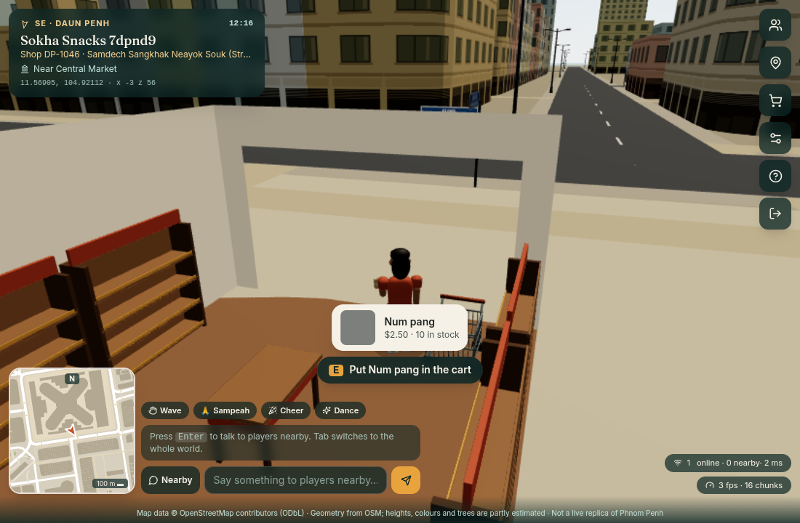 |
| 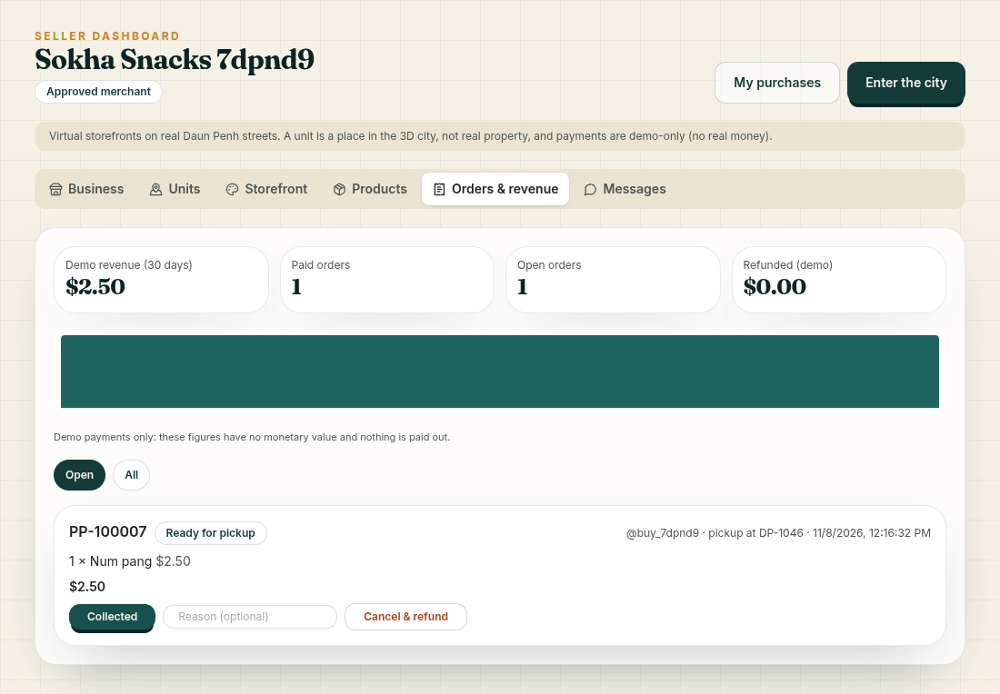 | 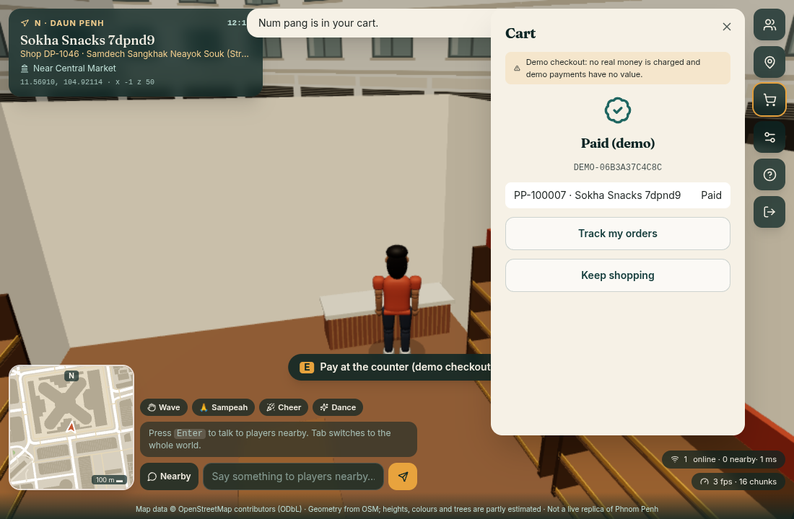 |
| 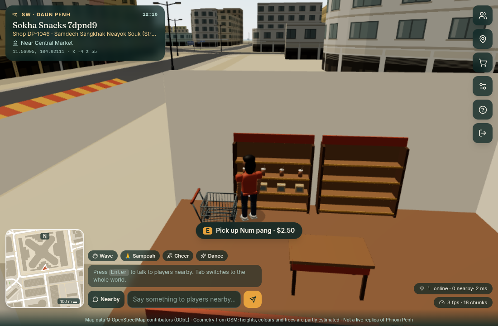 | 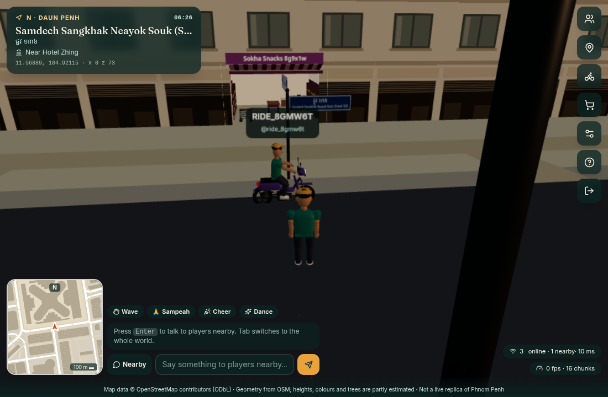 |
| 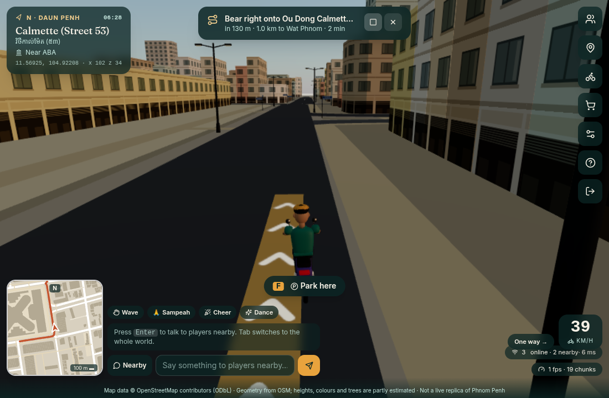 | 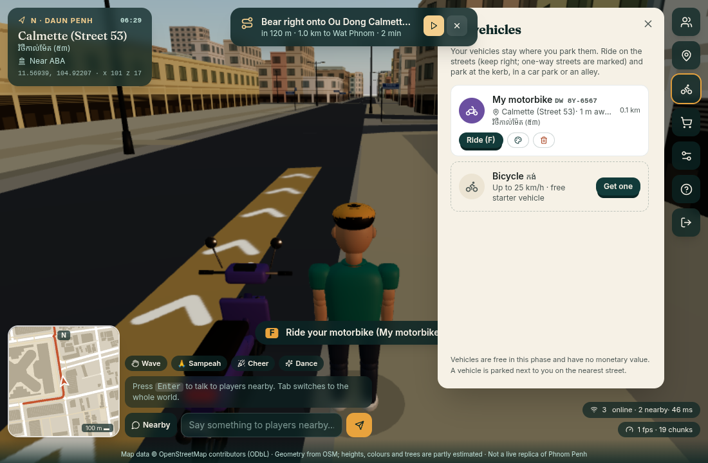 |

*Phase 2 screenshots: headless Chrome on the machine's Intel GPU (`tests/perf/tour.mjs`).
Phase 1, 3, 4 and 5 screenshots: software WebGL, as used by the automated tests (the Phase 3 image is
player A's view during the two-browser test: player B nearby, the chat line, the People panel
showing B as an online friend).*

---

## Stack

| Layer | Technology |
|---|---|
| Web | SvelteKit 2 · Svelte 5 · TypeScript · Tailwind CSS 4 · Three.js 0.180 · MapLibre GL 5 · proj4 |
| API | Python 3.13 · FastAPI · Pydantic 2 · SQLAlchemy 2 (async) · Alembic · GeoAlchemy2 · Shapely · pyproj · uv |
| Data | PostgreSQL 17 + PostGIS 3.5 + pg_trgm (Docker) · OpenStreetMap snapshots |
| 3D assets | Blender 4.3 (`bpy` scripts) → GLB |
| Tests | pytest + HTTPX (real PostGIS) · Vitest · node:test · Playwright (real Chrome) |

## Quick start (development)

Requirements: Docker, [uv](https://docs.astral.sh/uv/), Node 22+, Chrome or Chromium (for E2E).

```bash
cp .env.example .env        # then set POSTGRES_PASSWORD (also inside both URLs) and JWT_SECRET
                            #   openssl rand -hex 24 ; openssl rand -hex 32
docker compose up -d db     # PostGIS on 127.0.0.1:5440, also creates ppw_test

cd backend
uv sync
uv run alembic upgrade head
uv run python scripts/import_osm.py      # ~3 s: real Daun Penh → PostGIS + 90 world chunks
uv run python scripts/seed.py            # bootstrap admin (prints a password once)
uv run uvicorn app.main:app --port 8000  # API docs: http://127.0.0.1:8000/api/docs

cd ../frontend                            # new terminal
npm install
npm run dev                               # http://localhost:5173
```

> If your Docker CLI points at Docker Desktop but the system daemon is the one running, prefix
> commands with `DOCKER_HOST=unix:///var/run/docker.sock`.

**Verification codes:** no SMS or e-mail provider is connected yet. In development, the code is
shown in a dashed "Developer mode" box on the Verify screen and logged by the API. The API
refuses to start with this enabled when `APP_ENV=production`.

**Admin:** sign in as the seeded admin and open `/admin` to approve seller and driver applications.

### Full stack in Docker

```bash
docker compose --profile full up -d --build   # http://localhost:3000
```

The API container migrates, imports the OSM snapshot if the database has none, then serves.
`infrastructure/nginx/ppw.conf` is an example TLS front proxy.

## Using it

1. **Welcome**: Enter / Sign in / Create account / Learn about the platform.
2. **Create account**: username, email or phone (Cambodian `0…` numbers become `+855…`),
   password, display name, language, terms and privacy.
3. **Verify** the 6-digit code.
4. **Avatar**: build, skin tone, hairstyle, tee or hoodie, trousers or shorts, colours, up to
   3 accessories (cap, glasses, backpack, krama). Drag to rotate the 3D preview.
5. **Role**: visitor always; buyer immediate; seller and driver await approval.
6. **Location**: search the city, tap the map to pin a **private** delivery address (buyers
   only; must be inside Phnom Penh), pick a **public** spawn area, and choose visible or hidden.
7. **World**: WASD or arrow keys, Shift to run, drag to orbit, wheel to zoom, **M** for places
   (fast travel), **Esc** for help. The HUD shows the street (English and Khmer), nearby
   landmark, lat/lon and world x/z; the minimap is drawn from the same data.
8. **Multiplayer**: other visible players appear with their own avatars and name tags. **Enter**
   opens chat (Nearby ≈ 40 m or World), **1–4** play emotes (wave, sampeah, cheer, dance),
   **P** opens People: nearby players, friends with online status, requests, direct messages,
   and per-player actions (add friend, invite, message, mute, block, report). An invite shows a
   "Join" toast to your friend. The chip at the top shows the connection state and players online.
9. **Shops**: **M** lists the shops by distance (Browse, or Walk there). Walk through a shop's
   doorway; **E** at a shelf picks a product up, **E** at the cart puts it in, **E** at the
   counter (or **C** anywhere) opens the cart and the demo checkout. **/orders** tracks orders.
10. **Sell** (`/seller`): apply, then claim a unit on the map, customise the storefront, add
   products (photo, price, stock, 3D display model), fulfil orders, see demo revenue, answer
   customer messages.
11. **Vehicles** (**V**): take a free bicycle or motorbike (parked on the nearest street), walk
   to it (**Walk there**), press **F** to ride: **W/S** throttle and brake, **A/D** steer, keep
   right. The HUD shows speed, the OSM speed limit and one-way streets (and warns when you ride
   against one). **M** → *Directions by* walking, bicycle or motorbike → **Route** draws the way
   in the street and on the minimap; ▶ lets the autopilot walk or ride it. **F** again parks at the
   kerb, in a car park or an alley. **Bring it here** fetches a vehicle left far away.
12. **Admin** (`/admin`): merchants and their documents, claims at real businesses, disputes,
   restricted products, seller/driver role requests, and player reports.

## Tests and results (Phase 4, run on 2026-11-08)

```bash
cd backend  && uv run pytest && uv run ruff check . && uv run ruff format --check .
cd frontend && npm run check && npm test
# Browser tests start their own isolated stack (API :8001 on ppw_e2e + web :5174/:4174):
cd frontend && npx playwright test tests/phase1.spec.ts tests/phase2.spec.ts tests/phase3.spec.ts tests/phase4.spec.ts
cd frontend && npm run build && CAMPUS_PRODUCTION_TEST=1 npx playwright test tests/phase1.spec.ts tests/phase2.spec.ts tests/phase3.spec.ts tests/phase4.spec.ts
cd frontend && node tests/perf/measure.mjs        # real-GPU frame rates (dev servers)
```

| Suite | Result |
|---|---|
| Backend pytest (real PostGIS, real migrations, real OSM import, real WebSockets) | **106 passed** (17 new: 9 claims/units/merchants/media, 8 catalogue/cart/checkout/orders) |
| Ruff lint + format | clean |
| `svelte-check` | 0 errors, 0 warnings |
| Vitest (adds shop layout and doorway collision) | **58 passed** |
| Legacy CampusEats node tests (GLB integrity now covers all 49 models) | **10 passed** |
| Playwright E2E, isolated stack, dev server: Phases 1–4 (Phase 4: dashboard application → admin approval → claim → race → products and a 1 MB photo → walk in → E pick up → E into cart → demo checkout → fulfilment → collected) | **5 passed** (3.1 min) |
| Same E2E against the **production build** (adapter-node preview, upload limit, WebSocket proxy) | **5 passed** (3.1 min) |
| `docker compose --profile full build` + boot | both images build; health, units, categories and shop models served; media volume writable |
| GPU frame rate | not re-measured in Phase 4 (Phase 2: 60 fps on the Intel iGPU). Storefronts add a few hundred draw calls only near shops; to be profiled with many shops in Phase 8 |
| Legacy mall E2E (`tests/shopping.spec.js`) | not re-run (unchanged `/mall` code) |

What the backend tests cover: registration and validation, Argon2 hashing, login by username,
email or phone, per-account rate limiting, session revocation (replayed cookies rejected),
CSRF and Origin checks, tampered tokens, verification (expiry, reuse, attempt limits, resend
cooldown), role permissions and admin approval (403 for non-admins), onboarding order, the
address service area and the single default address, the explicit visibility opt-in, privacy
(addresses owner-only, absent from public cards and audit logs, hidden players undiscoverable),
projection accuracy (<0.1 % against geodesic distance), OSM parsing (width and height sources,
multipolygon courtyards, partial-geometry regression, stupas mapped as towers), stable ids
across re-import, spawn points on open ground, chunk ETags, search in English and Khmer, the
terrain profile and Python/TypeScript fixture, landmark overrides in the chunks, sign
placement at real intersections and clear of carriageways and buildings, and lamp spacing
along whole streets. **Phase 4:** units are storefronts of real non-residential buildings
(door on the front edge, heading out to the street, area exact), the unit map API, merchant
application and admin approval (documents private, magic-byte checked), two sellers claiming
the same unit concurrently (one 201, one 409), a race lost past the application check
(still 409), a live-claim insert bypassing the app (database refuses), claim limits, release
and expiry, evidence and review for real businesses, disputes upheld, transfers, the shop floor
becoming walkable only while the shop exists (and clients notified), photos re-encoded without
EXIF, prohibited and restricted categories, cart repricing and stock checks, server-priced
multi-merchant checkout, idempotency (replay and reuse), five concurrent payment confirmations
(exactly one succeeds, stock decremented once), access control on other people's payments and
orders, the order state machine with history, buyer refunds (once, stock restored), revenue,
expiry of unpaid checkouts, and age confirmation. **Phase 3:** WebSocket admission (Origin, login, onboarding), two players
seeing each other and movement sync, despawn on leave, hidden players never broadcast, a second
tab replacing the first, server rejection of teleports, walls, water and out-of-region moves,
interest areas across fast travel, protocol errors, the chat filter, nearby range vs world chat
and persistence, chat and travel rate limits, emotes, sign-out and suspension kicking a live
socket, resume within 15 minutes, spawn spreading under concurrent joins, the friend flow with
live notifications, invites and joining, mute vs block semantics, direct messages, and reports
with chat evidence through to admin chat-mute and suspension.

## Project layout

```text
backend/            FastAPI app
  app/core          config, security, database, errors, rate limit
  app/api/v1        auth, me, geo, world, players, admin, realtime (WebSocket), social
  app/services      accounts, onboarding, geo, world, audit, notifier, social
  app/multiplayer   world hub (rooms, interest grid, tick), protocol, movement validation, chat filter
  app/geography     regions + landmark overrides + terrain (single source of truth), projection,
                    OSM parser, streetscape (signs, lamps), importer
  app/models        identity, geo, admin, social, market (units, claims, merchants, shops, products, carts, orders, payments)
  app/marketplace   units (generation), merchants, claims, catalog, checkout (orders, demo payment), media, sweeper
  app/transport     specs (modes, speeds), network (OSM access → graph), routing (A*), area (ride/park rules),
                    parking (parked-vehicle index), vehicles (garage)
  migrations/       Alembic (0001: Phase 1 schema; 0002: multiplayer and social; 0003: marketplace; 0004: transport)
  scripts/          import_osm.py, seed.py, e2e_stack.py (isolated API for browser tests)
  tests/            89 tests against PostGIS (HTTP and WebSocket)
frontend/           SvelteKit app; server.js = production server with the WebSocket upgrade proxy
  src/routes        / · about · login · register · onboarding/{verify,avatar,role,location} · world · seller · orders · admin · legal · mall (legacy) · dev/assets (dev only)
  src/lib/api       typed client + endpoints
  src/lib/game/city engine, chunk worker + geometry, assembly, materials (facade shader), props,
                    lighting + sun, terrain, collision, chunk streaming
  src/lib/game/net  WorldSocket (reconnect), WorldSession (reactive state), Interpolator, RemotePlayers
  src/lib/game      avatar/ (+ emotes), legacy player/camera/cart/npc
  src/lib/components/world  ChatBox, PeoplePanel, ShopPanel, CartPanel; components/seller: dashboard tabs, UnitMap
  src/lib/game/shop Storefronts (walk-in shops), layout, ShopAssets
  src/lib/game/vehicles  specs (+ shared fixture), kinematics, RoadNetwork, route (lanes, guidance), RouteLine,
                    VehicleModels, Rider (seated IK pose)
  src/lib/geo       projection (proj4, mirrors the backend)
  static/models     49 Blender GLBs (29 CampusEats + avatar + 6 street props + 2 landmarks + 11 shop fittings and products)
  tests             Playwright (phase1/2/3.spec.ts, shopping.spec.js), legacy node tests, perf/ tools
tools/gis           fetch_osm.py + committed OSM snapshots (data/osm)
tools/blender       generate_avatars.py, generate_city_assets.py, generate_shop_assets.py, compress_glb.mjs, generate_assets.py (CampusEats)
infrastructure/     Dockerfiles, Postgres init, nginx example
docs/               PRD, SRS, HLD, LLD, ERD, API, DATA, ROADMAP, perf/, legacy/
```

## Phase 5 report: transportation

**Features implemented**

* **A routing graph from the real OSM roads.** The importer splits ways at shared OSM nodes into
  `road_nodes` / `road_edges` (1,109 nodes, 1,485 edges, 74 km), clipped to the playable area.
  Each edge has per-direction access masks for foot, bicycle and motorbike from the highway class
  and OSM access tags (`access`, `vehicle`, `motor_vehicle`, `motorcycle`, `bicycle`, `foot`,
  `oneway`, `oneway:bicycle`, roundabouts): 317 one-way edges, 100 private service roads
  excluded, and OSM speed limits where tagged. Chunk payloads carry the same masks for the client.
* **Routing.** `GET /routes`: A* by travel time (per-mode speeds, OSM limits, a wait at
  signals for vehicles); one-way streets bind vehicles, not pedestrians; the four nearest roads
  at each end are tried so dead-end fragments never block a route. Turn-by-turn steps with
  English and Khmer street names, measured over a 15 m baseline and merged across dual-named
  junctions. Road position ↔ world: `/roads/snap`, `/roads/position`.
* **Vehicles.** Blender models (original, generic): a step-through city bicycle with a front
  basket and an underbone motorbike with leg shield and mirrors; steerable bars and front wheel,
  spinning wheels, lean into turns, headlights and tail lights that glow at night. The rider is
  seated with two-bone leg IK (pedalling on the bicycle) and arm IK to the grips.
* **Garage (V).** One free starter vehicle per kind, parked on the nearest street next to you;
  repaint, give back, and a valet ("Bring it here", once a minute). Plates are virtual
  (`DW 3K-0427`). Vehicles persist where they were parked, with an odometer.
* **Riding (F).** W/S throttle and brake (motorbikes reverse slowly), A/D steer: a kinematic
  bicycle model with less lock at speed, 50 ms sub-steps for slow frames, a chase camera.
  The rider stays on roads their vehicle may use (carriageway + pavement, car parks) and slides
  along that edge. HUD: speed, OSM speed limit, one-way street, wrong-way warning.
* **Server validation.** Speed per mode (bicycle 25 km/h, motorbike 45 km/h, ×1.35 tolerance),
  the same building/water checks, vehicles never on shop floors, and the ride area (a wider
  margin than the client, so honest riders are never corrected: the E2E ride of 120+ m had no
  `offroad` correction). Mounting checks ownership and distance (3 m) and cannot race.
* **Parking.** At the kerb or on the pavement of a through road, anywhere in alleys and OSM car
  parks; never mid-carriageway or within 1–1.3 m of another vehicle. The server pulls over up to
  6 m and lines the vehicle up 0.6 m inside the kerb, parallel to the street. Leaving the world,
  fast travel and joining a friend park the vehicle (it never teleports with you).
* **Guidance.** Directions by walking, bicycle or motorbike from the Places panel (spawn areas,
  shops) or the garage ("Walk there"). The route is drawn in the street (a chevron ribbon in the
  right-hand lane: Cambodia drives on the right; the right lane of one-way streets; the pavement
  for walkers) and on the minimap, with the next turn, distance and time. The autopilot walks or
  rides it (pure-pursuit steering, slower in bends and under speed limits) and re-plans when you
  leave the route.
* **Sync.** Other players see riders on their vehicle (kind and colour; wheels, steering and
  lean derived from the motion) and parked vehicles in their area as world objects with small
  colliders. Owners are never identified to others; hidden players' vehicles are not shown, and a
  block hides vehicles both ways.

**Files.** Backend: `app/transport/` (specs, network, routing, area, parking, vehicles),
`app/models/transport.py`, migration `0004`, `app/schemas/transport.py`,
`app/api/v1/transport.py`, hub additions (mount, dismount, per-mode validation, parked-vehicle
interest management, auto-parking), the importer's `sync_road_graph`, chunk road masks and
`IMPORTER_VERSION`, `tests/test_transport.py`, `tests/test_vehicles.py`. Frontend:
`src/lib/game/vehicles/` (specs + shared fixture, kinematics, RoadNetwork, route, RouteLine,
VehicleModels, Rider), `net/ParkedVehicles.ts`, riding in `CityEngine.ts`, remote riders in
`RemotePlayers.ts`, `WorldSession` messages, `api/transport.ts`, `components/world/GaragePanel`,
`VehicleIcon`, the world page (HUD, directions, F/V keys), `tests/phase5.spec.ts`. Assets:
`tools/blender/generate_vehicle_assets.py` (2 GLBs, 56 and 66 KB). Docs: HLD, LLD, ERD, API,
SRS, DATA, ROADMAP, Blender README.

**Bugs found and fixed during Phase 5**

* **An upgraded database would have had no road graph.** `import_osm.py --if-empty` (Docker and
  the E2E stack) skipped the import whenever chunks existed, so a database migrated to 0004 kept
  Phase 4 chunks and an empty graph ("There is no street nearby to leave a vehicle on" in the
  first browser run). Imports are now stamped with `IMPORTER_VERSION` and outdated data is
  re-imported (a test pins the stamp).
* The four route query parameters shared one FastAPI `Query` object, which bound them wrongly
  (every route came back empty); they now use an `Annotated` type.
* Pulling over parked vehicles on the inner edge of the kerb band (mid-lane, visually); they are
  now lined up at the kerb and parallel to the street.
* "Walk there" stopped at the road position nearest the vehicle, which can be out of reach of a
  vehicle parked on the pavement; walking routes now finish at the exact destination.
* Pedestrian routes detoured around traffic signals; only vehicles wait at signals now.

**Known limitations (honest list)**

* **Bicycles and motorbikes only.** Cars and tuk-tuks (remorques) need four-wheel handling, a
  longer collision shape and models; the access bits and rules already include cars.
* **Traffic rules are partial.** One-way streets bind routes and the autopilot, and riding the
  wrong way is flagged, not refused. Speed limits are shown, not enforced. Turn restrictions,
  lane counts, signal phases and right of way are not modelled; there is no NPC traffic (no fake
  crowds) and no collision between players.
* **Speeds are game values**, and travel times outside OSM `maxspeed` tags use estimated class
  speeds (`docs/DATA.md`).
* **The graph ignores layers and bridges** (none in Daun Penh's drivable network today) and the
  riding area is the road corridor: vehicles cannot cross a park or a plaza.
* **Vehicles are free** until the Phase 7 wallet; one of each kind per player.
* The direction text is English (street names are bilingual); the chase camera does not avoid
  tree canopies (the Phase 2 limitation).
* GPU frame rates were not re-measured in Phase 5; riders add one vehicle model and a few joint
  updates per visible rider, parked vehicles one model each.

**Next development tasks: Phase 6, delivery.** Simulated delivery jobs on the routing graph:
driver profiles for approved drivers, job offers from paid orders with delivery fulfilment,
pickup at the shop door, a route to a virtual drop-off point (never the buyer's real address),
live tracking on the order page, and the delivery states the order machine already has.

## Phase 4 report: marketplace

**Features implemented**

* **Virtual shop units on real frontages.** The importer cuts 6 × 8 m units into
  non-residential OSM buildings whose wall faces a public street: **1,680** in Daun Penh, each
  with a permanent code (`DP-0412`), its street name (EN/KM) and outline. Units within 12 m of a
  named real business are verification-only. Units are virtual storefronts and never imply any
  right to the real building (stated in the UI and docs).
* **Exclusive, transactional claims.** A partial unique index allows one live claim per unit;
  the claim transaction locks the merchant row (limit 3 units each). Claims last 30 days,
  renew, expire (background sweeper plus lazy checks), can be released, transferred (the other
  merchant accepts) and revoked. Units at real businesses need a document and a note, wait for
  an administrator, and can be disputed by anyone; upholding a dispute revokes the claim.
* **Merchants.** One application: business name (EN/KM), category, description, customer
  contacts, private real address, opening hours, documents (PDF/JPEG/PNG, magic-byte checked,
  stored privately, admin download audited). Approval activates the seller role.
* **Seller dashboard** (`/seller`): business, units (MapLibre claim map with unit outlines
  coloured by status, plus a list and code search), storefront (name EN/KM, tagline, theme,
  colours, open/closed, live sign preview), products (category policy, price, stock,
  visibility, photo, 3D display model), orders with the allowed next steps, demo revenue chart,
  customer messages (direct messages).
* **Catalogue rules.** Integer cents with database CHECKs; prohibited categories refused
  (tobacco, medicines, weapons, other regulated goods); alcohol listed only after admin review
  and sold only with an 18+ confirmation. Photos are re-encoded to WebP (metadata such as GPS
  removed). Products are archived, not deleted, so order history stays intact.
* **Walk-in 3D storefronts.** At the real frontage: a 5 m doorway (collision gap and a shader
  cut-out, no chunk rebuild), bilingual sign, awning, themed interior, four Blender shelving
  units and an island table showing the products (several facings each, price tags, photos on
  labels), a shopping cart by the door and a checkout counter. The server lets players onto open
  shop floors, and a `shops` message keeps every client's storefronts and shelves current.
* **Shopping in 3D.** E at a shelf picks a product up (it appears in the avatar's hand, carry
  pose, product card); E at the cart adds it to the server cart and it appears in the 3D cart;
  E at the counter (or C) opens the cart. The directory (M) offers Browse and "Walk there"
  (an autopilot that walks normally, so the server validates it like any walking).
* **Checkout.** A combined cart repriced on every view, one checkout = one demo payment +
  one order per merchant, `Idempotency-Key` required, `PRICE_CHANGED` if the client's total is
  stale, stock reserved and released if unpaid after 15 minutes, a payment that cannot be
  completed twice, refunds simulated once per order. The 13-state order machine has explicit
  transitions and actors, with history.
* **Isolated E2E stack.** Browser tests now run against their own API (:8001) and database
  (`ppw_e2e`), so test bots never enter the development world (`backend/scripts/e2e_stack.py`,
  `frontend/playwright.config.ts`).

**Files.** Backend: `app/models/market.py`, migration `0003`, `app/marketplace/` (units,
merchants, claims, catalog, checkout, media, sweeper), `app/schemas/market.py`,
`app/api/v1/{market,merchant,shopping,admin_market}.py`, hub additions (open shop floors,
`shops`/`order` messages), `scripts/e2e_stack.py`, `tests/test_market_claims.py`,
`tests/test_market_shopping.py`. Frontend: `src/lib/api/market.ts`, `src/lib/game/shop/`
(Storefronts, layout, ShopAssets), doorway support in `collision.ts` and `materials.ts`, the
autopilot and carry pose in `CityEngine.ts`, `components/world/{ShopPanel,CartPanel}`,
`components/seller/*`, routes `/seller` and `/orders`, admin tabs, `playwright.config.ts`,
`tests/phase4.spec.ts`. Assets: `tools/blender/generate_shop_assets.py` (11 GLBs).
Infrastructure: media volume, upload size limits. Docs: HLD, LLD, ERD, API, SRS, DATA, ROADMAP,
privacy draft.

**Bugs found and fixed during Phase 4**

* A lost claim race answered **500 instead of 409**: after the rollback, the error message read
  an expired ORM object. The browser test's real race exposed it; a backend test now forces
  that path.
* New products never appeared on shelves already built in someone's city: product changes
  now broadcast a catalogue update.
* `FOR UPDATE` with eager joins failed in PostgreSQL ("nullable side of an outer join"):
  locks now name their table (`FOR UPDATE OF …`), which also avoids locking category rows.
* The first unit generator gave a third of its units unnamed back alleys; units now face
  public streets only (1,680 instead of 2,101).

**Known limitations (honest list)**

* **Demo money only.** No wallet balance yet (Phase 7); "Pay with demo funds" confirms a
  payment intent that moves nothing. No real payment provider is connected.
* **Pickup only.** Delivery fulfilment (driver assignment, tracking) is Phase 6; the delivery
  order states exist but are not reachable yet.
* **What a player carries is not visible to others**, and other players' shopping is not
  synchronised beyond their movement.
* Shop interiors use the unit's 6 × 8 m floor; the camera gives a cutaway view from above the
  ceiling, and interiors are lit uniformly (no per-shop lights).
* Units are generated geometrically: whether a real shop exists at that exact spot is
  unknown, and the "verification required" flag relies on OSM business points within 12 m.
* USD only (no riel prices); stock is per product, not per branch.
* The dashboard UI is English (shop and product names accept Khmer).
* Verification is a document upload and a human review; there is no check against an official
  business register.
* The background sweeper runs inside the single API process (fine for one process; Phase 8).

**Next development tasks (at the time): Phase 5, transportation** (delivered above).

## Phase 3 report: multiplayer

**Features implemented**

* **World server.** An authoritative hub inside the API process at `WS /api/v1/world/ws`
  (same origin, proxied by Vite in dev/preview, by `frontend/server.js` in Docker, nginx example
  included). Admission requires an allowed `Origin`, the revocable login session and completed
  onboarding. Logins are re-checked every 30 s, so signing out or a suspension disconnects
  the socket.
* **Rooms and interest management.** A room per playable region (capacity 150; a new shard
  opens when full). The room is a grid of 200 m cells; each player receives only the 3×3 cells
  around them. A 10 Hz tick sends spawn, despawn and changed positions only, through a bounded
  per-connection queue.
* **Server-side movement.** Every position is checked for reachable speed, region bounds,
  building footprints and water using the same OSM data as the client. Invalid moves get a
  `correct` back. Fast travel and joining a friend are server teleports. Arrivals are spread
  out, including under concurrent joins.
* **Remote players.** Real avatars from each player's customisation, snapshot interpolation
  (100 ms behind), walking gait, name tags, speech bubbles, emotes (wave, sampeah, cheer, dance).
  Only registered, online and visible players appear. Nothing is simulated.
* **Chat.** Nearby (40 m) and world channels, direct messages (REST plus live delivery), text
  normalisation, a length cap, profanity masking with flagging, rate limits and chat-mutes.
* **Social.** Friends (requests, accept or decline, unfriend, mutual auto-accept) with
  online presence, invites with a one-click join, mute (chat only) and block (both players
  disappear for each other immediately and the friendship ends).
* **Safety and moderation.** Reports carry the reported player's last 24 h of public chat and
  the DMs they sent the reporter. The admin queue offers dismiss, warn, chat-mute (1 h to 7 days)
  and suspend, which apply to the live session immediately and are audited.
* **Persistence.** `player_sessions` keeps each connection and its last *virtual* position;
  reconnecting within 15 minutes resumes there.
* **Client UI.** Connection chip, online count, chat box, People panel (Nearby, Friends,
  Messages), emote bar, toasts, keyboard shortcuts. The legacy "Solo preview" label is gone.

**Files.** Backend: `app/multiplayer/` (hub, protocol, validation, chatfilter),
`app/models/social.py`, `app/services/social.py`, `app/api/v1/realtime.py`,
`app/api/v1/social.py`, the admin report endpoints, migration `0002`, `tests/test_multiplayer.py`
and `tests/test_social.py`. Frontend: `src/lib/game/net/` (protocol, WorldSocket, Interpolator,
RemotePlayers, WorldSession), `src/lib/game/avatar/emotes.ts`, `ChatBox.svelte`,
`PeoplePanel.svelte`, the world and admin pages, `server.js`, `tests/phase3.spec.ts` and
`tests/perf/two-players.mjs`. Infrastructure: the frontend Dockerfile runs `server.js`, and nginx
has a WebSocket location. Docs: HLD, LLD (protocol, close codes), ERD, API, SRS, ROADMAP, and
the privacy draft.

**Bugs found and fixed during Phase 3**

* The friendship pair index was built on string constants and would have allowed only one
  friendship in the whole table. It now indexes `least/greatest` of the real columns.
* Two players joining at the same moment were placed on the same spot. Registration in the room
  now happens before the first database await, and arrivals are spread out.
* A Phase 1 E2E regression came from walking speed scaling with frame rate on software-rendered
  browsers (around 2 fps): a 0.1 s step clamp caused slow motion. The engine now uses real
  elapsed time with a 0.25 s clamp.

**Known limitations (honest list)**

* **One API process.** The hub is in memory, so a deployment runs a single API worker (about
  150 players per room; total capacity has not been load-tested). Redis pub/sub and room
  pinning for scale-out are planned for Phase 8, and the rate limiter is still in-process.
* **The chat filter is basic and English-only.** Khmer terms need native-speaker input.
  Moderators cannot yet hide individual messages.
* **No chat retention job yet.** Messages are kept indefinitely in development; a retention
  period must be set before launch (the privacy draft says so).
* **The server does not collide with trees and poles** (the client does), so a modified client
  could walk through a lamp post, but never through a building or into the river.
* **Remote avatars are cosmetic**: no player-to-player collision (vehicles arrived in Phase 5).
* Software-rendered E2E browsers run at about 1–3 fps, so those tests check movement by
  distance rather than timing. Real-GPU sync was verified separately with `two-players.mjs`.
* **E2E tests shared the dev API and world hub** during Phase 3, so test bots were visible to
  anyone online there (two bot chat lines and "(e2e) hello from B"). Fixed in Phase 4: browser
  tests now use an isolated API and database.
* Earlier limitations still apply: no SMS or e-mail provider, a stylised city with mostly
  estimated heights, an English-only UI, and draft legal pages.

**Next development tasks (at the time): Phase 4, marketplace** (delivered above).

## Phase 2 report: 3D city

**Features implemented**

* **Landmarks.** Phsar Thmei: the real X-plan wings plus a Blender Art Deco dome (louvred drum,
  16 ribs, lantern) reaching the published 26 m. Wat Phnom: a Blender stupa on the OSM stupa
  footprint (newly parsed: OSM maps it as `man_made=tower`) and a tiered Khmer roof with chofa
  finials on the vihara. Temples and pagodas get Khmer roofs automatically. Two duplicate OSM
  footprints are hidden. Every override records its height source (`reference` or `estimated`).
* **Terrain.** Wat Phnom's 27 m hill, a single function shared by Python and TypeScript (test
  fixtures keep them identical). Roads, buildings, props, labels, signs, the avatar and the
  camera all follow it.
* **Street furniture.** New Blender GLBs: rain tree, ornamental tree, sugar palm, double-arm
  boulevard lamp, traffic signal, sign post. They are Meshopt-compressed, instanced per chunk,
  and given colliders.
* **Street signs.** 181 blue bilingual signs (Khmer above English) at real named
  intersections, one blade per street, readable from both sides.
* **Lamps.** 748 generated along whole streets (OSM maps none here). At night they light warm
  pools on the ground.
* **Facades.** A shader tiles 4 m × 3.3 m bays: shophouse ground floors with rolled shutters
  and goods, windows above, and about 42 % of windows plus every shop lit at night.
* **Day/night.** The real sun over Phnom Penh (UTC+7) or Morning, Midday, Sunset and Night
  presets: sun and moon, sky, fog and exposure. The HUD shows the clock.
* **Performance.** Chunk fetching and triangulation moved to two Web Workers with zero-copy
  transfer; at most one chunk is assembled per frame; shadows are cached on a 12 m grid; distant
  detail is hidden. Result: a locked 60 fps on an Intel Alder Lake-N iGPU (render ≈ 4 ms/frame).
  The first Phase 2 build had dropped to 43 fps; the measurement-driven fixes are in
  `docs/perf/README.md`.
* **Tooling.** A dev-only `/dev/assets` gallery, an asset compression script, and GPU
  benchmark, probe, ablation and screenshot-tour scripts.

**Bugs found and fixed during Phase 2:** lamps were missing on short OSM street fragments
(streets are now merged before spacing); street-sign posts stood at the carriageway edge
(the bisector offset ignored the corner angle, which a test caught); a temple got shopfronts;
night lighting was too dark to play.

**Known limitations (honest list)**

* **Verification delivery** is not connected to an SMS or e-mail provider (dev code on screen;
  production refuses).
* **Stylised, not photorealistic.** 97.8 % of building heights are estimated. Facade colours,
  window lighting, tree species, park trees and all street lamps are generated. The hill shape
  and the landmark proportions are approximations (`docs/DATA.md` lists every source).
* **Performance is measured on one machine** (Intel ADL-N iGPU). Other GPUs, phones and
  high-DPI screens are not yet profiled.
* The camera can end up under tree canopies (crowns are not occluders). There is no entering
  buildings, jumping or physics.
* **The UI is English only.** Khmer is used for place names and street signs; UI translation
  needs native review.
* The rate limiter is in-process (one API worker). (Phase 3 moved Redis to Phase 8.)
* The terms and privacy pages are drafts, not legal documents.

## Data and licences

* Map data © [OpenStreetMap contributors](https://www.openstreetmap.org/copyright), ODbL 1.0.
  Snapshot dates, coverage and accuracy: `docs/DATA.md`.
* Location-picker base map: OpenFreeMap / OpenMapTiles (configurable: `PUBLIC_MAP_STYLE_URL`).
* 3D models: original Blender work, CC0 (`frontend/static/models/LICENSE.txt`).
* **Virtual property is not real property, and demo credits have no monetary value.** Real
  payments will be added only through a licensed provider, after Cambodian legal and
  regulatory advice.
