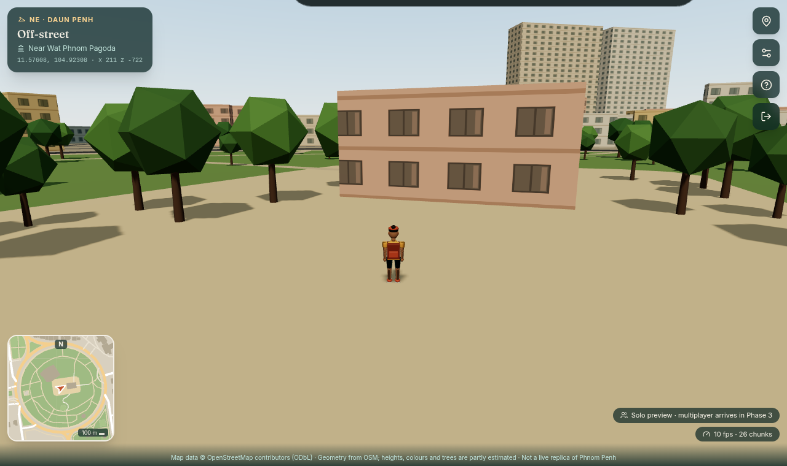
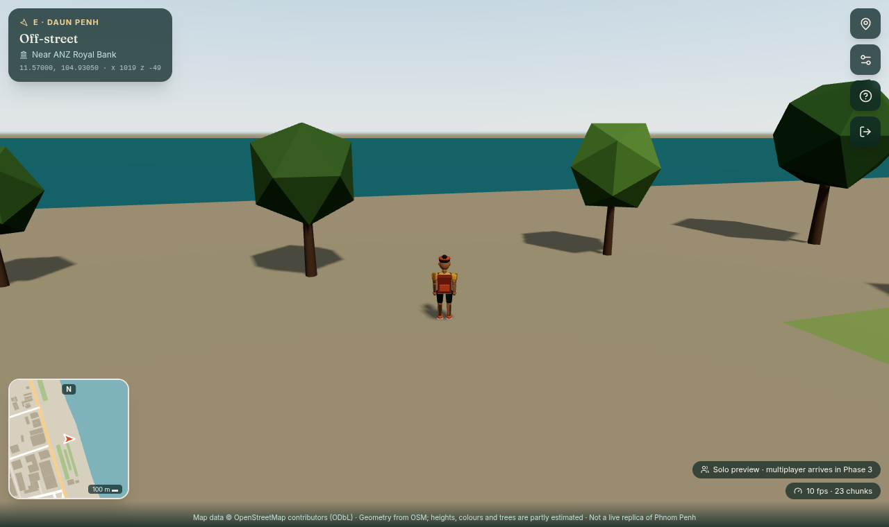

# Phnom Penh Digital World · ពិភពឌីជីថលភ្នំពេញ

A multiplayer 3D city, marketplace, transport and delivery platform built on **real Phnom Penh
map data**. This repository grew out of two existing projects, which are left untouched:

* **CampusEats World** (`~/Downloads/campuseats-world`): the SvelteKit + Three.js 3D
  shopping game with 29 Blender GLBs. Its engine pieces (asset loading, articulated character
  animation) are reused, and the food court still runs at **`/mall`**.
* **CampusEats** (`~/Desktop/campusEats`): the FastAPI + PostgreSQL ordering backend. Its
  core (config, Argon2 auth, CSRF, error envelope, rate limiting, Alembic, real-DB tests) is
  reused. Its canteen ordering and demo-payment code are the reference for Phases 4 and 7.

**Status: Phase 1 (Foundation) is complete.** A new user can register, verify, build an avatar,
choose roles, pick a private delivery address and a public spawn area on a real map, then walk
the real streets of Daun Penh in 3D. Multiplayer, shops, vehicles, delivery and the wallet come
in later phases (`docs/ROADMAP.md`).

| | |
|---|---|
|  |  |
|  |  |

*Screenshots come from headless Chrome with **software** WebGL, used by the automated tests.*

---

## Stack

| Layer | Technology |
|---|---|
| Web | SvelteKit 2 · Svelte 5 · TypeScript · Tailwind CSS 4 · Three.js 0.180 · MapLibre GL 5 · proj4 |
| API | Python 3.13 · FastAPI · Pydantic 2 · SQLAlchemy 2 (async) · Alembic · GeoAlchemy2 · Shapely · pyproj · uv |
| Data | PostgreSQL 17 + PostGIS 3.5 + pg_trgm (Docker) · OpenStreetMap snapshots |
| 3D assets | Blender 4.3 (`bpy` scripts) → GLB |
| Tests | pytest + HTTPX (real PostGIS) · Vitest · node:test · Playwright (real Chrome) |

## Quick start (development)

Requirements: Docker, [uv](https://docs.astral.sh/uv/), Node 22+, Chrome or Chromium (for E2E).

```bash
cp .env.example .env        # then set POSTGRES_PASSWORD (also inside both URLs) and JWT_SECRET
                            #   openssl rand -hex 24 ; openssl rand -hex 32
docker compose up -d db     # PostGIS on 127.0.0.1:5440, also creates ppw_test

cd backend
uv sync
uv run alembic upgrade head
uv run python scripts/import_osm.py      # ~3 s: real Daun Penh → PostGIS + 90 world chunks
uv run python scripts/seed.py            # bootstrap admin (prints a password once)
uv run uvicorn app.main:app --port 8000  # API docs: http://127.0.0.1:8000/api/docs

cd ../frontend                            # new terminal
npm install
npm run dev                               # http://localhost:5173
```

> If your Docker CLI points at Docker Desktop but the system daemon is the one running, prefix
> commands with `DOCKER_HOST=unix:///var/run/docker.sock`.

**Verification codes:** no SMS or e-mail provider is connected yet. In development, the code is
shown in a dashed "Developer mode" box on the Verify screen and logged by the API. The API
refuses to start with this enabled when `APP_ENV=production`.

**Admin:** sign in as the seeded admin and open `/admin` to approve seller and driver applications.

### Full stack in Docker

```bash
docker compose --profile full up -d --build   # http://localhost:3000
```

The API container migrates, imports the OSM snapshot if the database has none, then serves.
`infrastructure/nginx/ppw.conf` is an example TLS front proxy.

## Using it

1. **Welcome**: Enter / Sign in / Create account / Learn about the platform.
2. **Create account**: username, email or phone (Cambodian `0…` numbers become `+855…`),
   password, display name, language, terms and privacy.
3. **Verify** the 6-digit code.
4. **Avatar**: build, skin tone, hairstyle, tee or hoodie, trousers or shorts, colours, up to
   3 accessories (cap, glasses, backpack, krama). Drag to rotate the 3D preview.
5. **Role**: visitor always; buyer immediate; seller and driver await approval.
6. **Location**: search the city, tap the map to pin a **private** delivery address (buyers
   only; must be inside Phnom Penh), pick a **public** spawn area, and choose visible or hidden.
7. **World**: WASD or arrow keys, Shift to run, drag to orbit, wheel to zoom, **M** for places
   (fast travel), **Esc** for help. The HUD shows the street (English and Khmer), nearby
   landmark, lat/lon and world x/z; the minimap is drawn from the same data.

## Tests and results (run on 2026-11-08)

```bash
cd backend  && uv run pytest && uv run ruff check . && uv run ruff format --check .
cd frontend && npm run check && npm test
cd frontend && npx playwright test tests/phase1.spec.ts                    # needs API + dev server
cd frontend && npm run build && CAMPUS_PRODUCTION_TEST=1 npx playwright test tests/phase1.spec.ts
```

| Suite | Result |
|---|---|
| Backend pytest (real PostGIS, real Alembic migration, real OSM import) | **56 passed** |
| Ruff lint + format | clean |
| `svelte-check` (TypeScript strict for new code) | 0 errors, 0 warnings |
| Vitest (projection vs pyproj, collision, avatar ↔ GLB contract, API client, road geometry) | **29 passed** |
| Legacy CampusEats node tests (GLB integrity incl. new avatar, cart/camera/crowd logic) | **10 passed** |
| Playwright Phase 1 E2E (full onboarding → 3D world → walk → reload resume; guards), dev server | **2 passed** |
| Same E2E against the **production build** (`vite build`, adapter-node) | **2 passed** |
| Legacy mall E2E (`tests/shopping.spec.js`, now served at `/mall`) | **2 passed** (3.4 min) |
| `docker compose --profile full build` + boot | both images build; migrate → import-skip → serve; registration through the web container works |

What the backend tests cover: registration and validation, Argon2 hashing, login by username,
email or phone, per-account rate limiting, session revocation (replayed cookies rejected),
CSRF and Origin checks, tampered tokens, verification (expiry, reuse, attempt limits, resend
cooldown), role permissions and admin approval (403 for non-admins), onboarding order, the
address service area and the single default address, the explicit visibility opt-in, privacy
(addresses owner-only, absent from public cards and audit logs, hidden players undiscoverable),
projection accuracy (<0.1 % against geodesic distance), OSM parsing (width and height sources,
multipolygon courtyards, partial-geometry regression), stable ids across re-import, spawn
points on open ground, chunk ETags, and search in English and Khmer.

## Project layout

```text
backend/            FastAPI app
  app/core          config, security, database, errors, rate limit
  app/api/v1        auth, me, geo, world, players, admin
  app/services      accounts, onboarding, geo, world, audit, notifier
  app/geography     regions (single source of truth), projection, OSM parser, importer
  app/models        identity, geo, admin (+ multiplayer/marketplace/delivery/payments packages reserved)
  migrations/       Alembic (0001: Phase 1 schema, PostGIS + pg_trgm)
  scripts/          import_osm.py, seed.py
  tests/            56 tests against PostGIS
frontend/           SvelteKit app
  src/routes        / · about · login · register · onboarding/{verify,avatar,role,location} · world · admin · legal · mall (legacy)
  src/lib/api       typed client + endpoints
  src/lib/game      avatar/, city/ (engine, builders, chunk streaming, collision), legacy player/camera/cart/npc
  src/lib/geo       projection (proj4, mirrors the backend)
  static/models     30 Blender GLBs (29 CampusEats + avatar.glb)
  tests             Playwright (phase1.spec.ts, shopping.spec.js) + legacy node tests
tools/gis           fetch_osm.py + committed OSM snapshots (data/osm)
tools/blender       generate_avatars.py (new), generate_assets.py (CampusEats)
infrastructure/     Dockerfiles, Postgres init, nginx example
docs/               PRD, SRS, HLD, LLD, ERD, API, DATA, ROADMAP, legacy/
```

## Phase 1 report

**Features implemented:** authentication (Argon2id, revocable server-side sessions, CSRF);
registration with email or phone and verification; multi-role model with admin approval and
an admin review page; profiles and language preference; modular Blender avatar with live
preview; MapLibre location picker with city search, reverse lookup, a private delivery
address validated against the real Phnom Penh boundary, a public spawn area and explicit
visibility; PostGIS geography (regions, roads, buildings, areas, landmarks, street features,
places, chunks, provenance); a coordinate system shared by Python and TypeScript; one playable
neighbourhood (Daun Penh: Central Market, Wat Phnom, Canadia Garden, Sisowath Quay riverside)
streamed in 200 m chunks with collisions, an orbit camera with occlusion, animated avatar,
minimap, bilingual street names, fast travel and adaptive quality; audit logging; Docker
Compose deployment.

**Known limitations (honest list):**

* **No multiplayer yet** (Phase 3). The world says so in its HUD ("Solo preview"). No other
  avatars are faked.
* **Verification delivery** is not connected to an SMS or e-mail provider. Development shows the
  code on screen; production deliberately refuses to send.
* **Visual fidelity is stylised, not photorealistic.** Footprints are real, but **97.8 % of
  building heights are estimated** (OSM lacks them). Facade colours, windows, sidewalks, lane
  markings and park trees are generated. Terrain is flat (Wat Phnom's hill is missing).
  Landmarks such as Phsar Thmei's dome are plain extrusions. Trees and lamps are primitives,
  not Blender models yet. See `docs/DATA.md`.
* **Performance was measured only with headless software WebGL** (10–13 fps, a lower bound).
  It has not been profiled on real consumer GPUs. Adaptive quality is in place but unverified
  on low-end hardware.
* The camera ray and collision use 2D footprints. There is no full physics, jumping or entering
  buildings.
* **The UI is English only.** Khmer is stored as a preference and used for place names; Khmer
  UI translation needs native review.
* The rate limiter is in-process (one API worker). Redis arrives with Phase 3.
* The terms and privacy pages are **drafts** for development, not legal documents.
* The avatar GLB is 658 KB uncompressed (Draco/meshopt compression is a Phase 2 task).
  Three.js (189 KB gzip) and MapLibre (276 KB gzip) load only on the pages that use them.

**Next development tasks:** see `docs/ROADMAP.md` (Phase 2: landmark models, terrain, street
furniture GLBs, facades, day/night, interiors via `/mall`, real-hardware profiling, Khmer UI).

## Data and licences

* Map data © [OpenStreetMap contributors](https://www.openstreetmap.org/copyright), ODbL 1.0.
  Snapshot dates, coverage and accuracy: `docs/DATA.md`.
* Location-picker base map: OpenFreeMap / OpenMapTiles (configurable: `PUBLIC_MAP_STYLE_URL`).
* 3D models: original Blender work, CC0 (`frontend/static/models/LICENSE.txt`).
* **Virtual property is not real property, and demo credits have no monetary value.** Real
  payments will be added only through a licensed provider, after Cambodian legal and
  regulatory advice.
