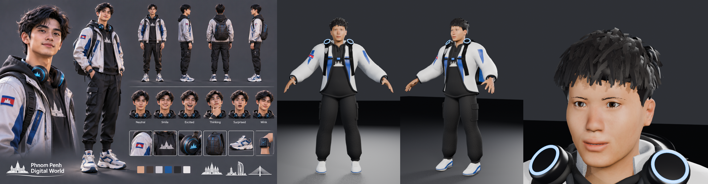
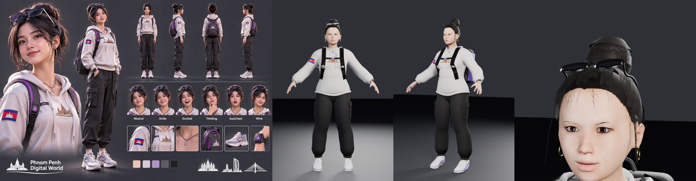

# Avatar generator: realistic Cambodian avatars for Phnom Penh Digital World

Two rigged, animated, full-body characters built in Blender from Python. They follow
`references/male.png` and `references/female.png` and export as GLB files for Three.js.

| | |
|---|---|
|  |  |

`previews/` holds turnarounds (`*_sheet.png`), the browser test's animation and expression
sheets (`animations.png`, `expressions.png`) and every viewer screenshot (`previews/viewer/`).

## What you get

| File | Use |
|---|---|
| `output/male_avatar.glb`, `output/female_avatar.glb` | **High quality**: close-ups, avatar editor, marketing renders |
| `output/male_avatar_game.glb`, `output/female_avatar_game.glb` | **Gameplay**: 7 draw calls each, meshopt-compressed |
| `output/*_avatar.blend` | Blender scenes, regenerated by the build and not committed (they reference generated textures) |
| `output/*_stats.json` | Triangles, vertices, materials, textures and sizes for each quality level |
| `viewer/` | Three.js viewer (r180, the game's own copy) plus an automated browser test |

Both characters have:
- **Skeleton and pose:** a 52-bone humanoid skeleton with Mixamo bone names (`mixamorig:Hips` … fingers), in a neutral A-pose. Mixamo and other Mixamo-retargeted clips play on it without remapping.
- **Animation clips:** 13 clips. The locomotion clips are retargeted motion capture: `Walk`, `Run` (a jog), `Sprint`, and a `Jump` / `Fall` / `Land` set. The others are keyframed: `Idle`, `Wave`, `Sit`, `Talk`, `Dance`, `Greet` and `Cheer`. `Greet` is the Cambodian *sampeah*: palms together at the chest with a slight bow.
- **Face shapes:** 7 morph targets, `Smile`, `Excited`, `Surprised`, `Thinking`, `Wink`, `Blink` and `MouthOpen` (for lip-sync).
- **Scale and orientation:** metres, Y up, facing +Z after export, feet on y = 0. The male is 1.72 m tall and the female 1.62 m.

## How to build

```bash
cd avatar-generator
./build_all.sh                 # fetch → build → export → compress → validate → previews → browser test
PREVIEW_SIZE=1080 ./build_all.sh # bigger final previews (default 720 px; a 240 px check pass runs first)
node viewer/serve.mjs          # then open http://127.0.0.1:5190/viewer/
```

The full run takes about 2 minutes here.

Individual steps (Blender needs the project's private profile and the system Python, for NumPy and Pillow):

```bash
python3 scripts/fetch_assets.py                       # downloads (sha256-pinned) + installs, once
export BLENDER_USER_RESOURCES=$PWD/assets/blender-user
blender --background --python-use-system-env --python scripts/generate_male.py            # → output/male_avatar.blend
blender --background --python-use-system-env --python scripts/generate_female.py -- --stage body   # stop early: body|outfit|all
blender --background output/male_avatar.blend --python-use-system-env --python scripts/export_glb.py
blender --background output/male_avatar.blend --python-use-system-env \
        --python scripts/render_previews.py -- --out previews/male --size 360 --views front,34,side,back,face
node viewer/test_viewer.mjs                            # browser test → previews/viewer/report.json
python3 scripts/make_sheets.py                         # contact sheets in previews/
python3 scripts/install_to_game.py                     # game GLBs + manifest → frontend/static/models/characters/realistic/
```

`BLENDER_USER_RESOURCES` points Blender at `assets/blender-user`. The MakeHuman add-on and its
assets are installed there, so your own Blender settings and add-ons are never changed.

## Environment it was built on

| | |
|---|---|
| OS | Debian GNU/Linux 13 (trixie), kernel 6.12 |
| CPU | Intel Core 3 N355, 8 cores; **no dedicated GPU** (Intel ADL-N integrated graphics, Mesa) |
| RAM / disk | 7.5 GB (about 2 GB free during the build) / 156 GB free |
| Blender | 4.3.2 (Debian package; Python 3.13 with system NumPy 2.5 and Pillow 11.1) |
| Node | 22, used for the viewer, the test and gltf-transform from `frontend/node_modules` |

Hardware use:
- No CUDA or OptiX is needed.
- Preview renders use Eevee on the integrated GPU through Mesa, about 2 s per 720 px view. If Eevee can't start, the script falls back to CPU Cycles.
- A build uses well under 1 GB of RAM.

## How the characters are made

There is no free tool that turns a photo into a rigged, customisable human, and the brief rules
out paid AI APIs. So the bodies are not built from primitives. They start from the
**MakeHuman base mesh**, driven by **MPFB 2** (MakeHuman Plugin For Blender) without the UI.
That gives anatomically correct topology, real face proportions, skin, eyes, teeth and
production skin weights. Everything the references need that MakeHuman does not have is
procedural Python.

| Part | Source |
|---|---|
| Body, face shape, height | MakeHuman macro targets plus about 20 detail targets (`scripts/characters.py`). Young adult (about 23), mostly Asian ethnic mix. The male has a squarer jaw, the female a softer oval face with larger eyes. |
| Expressions | MakeHuman's Asian FACS-style expression units mixed into 7 shape keys, then carried onto brows and lashes. A light smile is part of the neutral face. |
| Skin, eyes, brows, lashes, teeth | MakeHuman CC0 textures. The skin is regraded to each character's tone and the irises recoloured dark brown (`setup_materials.py`). |
| Hair | MakeHuman base hair for scalp coverage, plus about 700 procedural hair cards (`hair.py`). The male has tousled hair with a fringe that stops above the brows. The female has an up-do with a wrapped messy bun, see-through bangs and face-framing strands. |
| Hoodie, jacket, cargo joggers | Tailored from the body surface (`garments.py`): cut along body regions, smoothed into fabric (volume-preserving Taubin smoothing), wrapped, eased and given folds. Layers are pushed outside each other: pants, then hoodie, then jacket. Ribbed cuffs, hems and waistband, a hood, drawstrings, cargo pockets with flaps, a zip, a collar and the jacket's blue panels are cut along straight planes. Skin hidden under fabric is deleted. |
| Sneakers | MakeHuman CC0 `shoes05`, thickened into a chunky sole and recoloured by region: midsole line, side stripe, heel counter, socks, plus procedural laces. |
| Backpack, headphones, smartwatch, sunglasses, hoop earrings, necklace | Procedural, placed by ray casts onto the dressed body (`accessories.py`) |
| Chest print, flag patch, backpack print, watch face | Original drawings generated with Pillow. The Angkor-style temple print is our own drawing. The Cambodian national flag is public domain. They are applied as decals conformed to the fabric. |
| Rig and clips | MPFB's `mixamo` rig. Locomotion is CMU motion capture retargeted onto the rig (`mocap.py`, see below). The other clips are keyframed procedurally from pose specifications (`setup_rig.py`), with two-bone IK for the sampeah hands. |

### Motion-captured locomotion (`scripts/mocap.py`)

The walk, jog, sprint and jump come from the CMU Graphics Lab Motion Capture Database, using
the BVH conversion by Bruce Hahne. `fetch_assets.py` downloads four takes, each pinned by
SHA-256, into the git-ignored `assets/vendor/mocap/`.

| Clip | Source take | Natural speed (male / female) |
|---|---|---|
| `Walk` | subject 16, take 21 (walk) | 1.50 / 1.36 m/s |
| `Run` | subject 35, take 17 (jog) | 2.58 / 2.41 m/s |
| `Sprint` | subject 16, take 45 (run), strides lengthened ×1.3, extra forward lean | 4.75 / 4.31 m/s |
| `Jump`, `Fall`, `Land` | subject 16, take 1 (jump), cut at take-off, apex and landing | — |

How a take becomes a clip:
1. **Retarget.** Every cgspeed BVH starts with a T-pose frame, facing −Y with the subject's left at +X, the same convention as this rig. Each bone's world rotation since that T-pose is applied to the matching rig bone, measured from the rig bone's own T-pose direction. The hips' bounce and sway are scaled by the leg-length ratio.
2. **Cut one cycle.** The loop runs from one left heel strike to the next (the left foot furthest ahead of the hips). The seam's small mismatch is spread over the cycle, and forward travel is removed so the clip plays in place.
3. **Ground the feet.** The hips are shifted so the lowest ankle sits at the rig's rest ankle height (no floating or sinking).
4. **Measure the natural speed.** This is the median backward speed of a planted foot relative to the hips. The game plays each clip at its ground speed divided by this number, so the feet don't skate. The value goes into the manifest as `walk_speed`, `run_speed` and `sprint_speed`.

Because every stride clip starts at the same heel strike, the game can crossfade Walk ↔ Run ↔
Sprint at the same point of the stride. Fingers get a relaxed curl, since the capture has no
finger motion.

## Quality levels

Measured from the exported files (`output/*_stats.json`) and the browser test
(`previews/viewer/report.json`, Chrome with ANGLE/Vulkan on the Intel iGPU, 1280×800).

| | Male high | Male game | Female high | Female game |
|---|---|---|---|---|
| Triangles | 71,280 | 30,495 | 63,000 | 25,806 |
| Vertices | 41,147 | 20,456 | 35,669 | 16,762 |
| Meshes / materials | 69 / 34 | 7 / 7 | 76 / 31 | 7 / 7 |
| Draw calls per render pass | 73 | 7 | 79 | 7 |
| Largest textures | skin 2048², hair 1024², strands 1024² | skin 1024², hair atlas 1024×512 | same as male | same as male |
| Texture pixels | 9.7 M | 2.1 M | 9.7 M | 2.1 M |
| GLB size | 6.05 MB | **1.31 MB** (meshopt; 2.67 MB raw) | 5.93 MB | **1.38 MB** (meshopt; 2.53 MB raw) |
| Load and parse in Chrome | 234 ms | 123 ms | 249 ms | 126 ms |

Both characters animating together hold **60 fps** at both quality levels (p95 frame time 16.8 ms,
vsync-capped) on this integrated GPU.

How the game version is reduced:
- **Meshes:** decimated, with the body at 33% and garments at about 26%. The face morphs are rebuilt on the decimated body.
- **Flat-colour parts:** every flat-colour part (clothes, shoes, bag, straps, jewellery, headphones) is merged into one "Outfit" mesh. It uses a 128² palette texture plus a metal/roughness and emission palette, with cells aligned to powers of two so colours don't bleed into each other at a distance.
- **Atlases:** hair, brows with lashes, and decals each get one small atlas.
- **Dropped:** the tongue.
- **Compression:** the game GLBs are meshopt-compressed, as the game's own models are. Load them with `MeshoptDecoder`, which ships with Three.js. The high-quality GLBs are left uncompressed for maximum compatibility.

## Using them in Three.js / SvelteKit

```js
import * as THREE from 'three';
import { GLTFLoader } from 'three/addons/loaders/GLTFLoader.js';
import { MeshoptDecoder } from 'three/addons/libs/meshopt_decoder.module.js';

const gltf = await new GLTFLoader().setMeshoptDecoder(MeshoptDecoder).loadAsync('/models/male_avatar_game.glb');
const avatar = gltf.scene;                               // metres, faces +Z, feet at y = 0
avatar.traverse((o) => { if (o.isMesh) { o.castShadow = true; o.frustumCulled = false; } });
const mixer = new THREE.AnimationMixer(avatar);
const clips = Object.fromEntries(gltf.animations.map((c) => [c.name, mixer.clipAction(c)]));
clips.Walk.play();                                       // Idle Walk Run Sprint Jump Fall Land Wave Sit Talk Dance Greet Cheer
// per frame: mixer.update(dt)

// Face: morph targets on the body and on the brows/lashes mesh.
avatar.traverse((o) => {
	if (o.morphTargetDictionary?.Smile !== undefined) o.morphTargetInfluences[o.morphTargetDictionary.Smile] = 0.6;
});
```

Three.js strips the colon from bone names (`mixamorig:LeftHand` becomes `mixamorigLeftHand`), so
use `getObjectByName('mixamorigLeftHand')`. Mixamo FBX clips retargeted to this rig use the same
names. Hair and brows use `alphaMode: MASK`; with an MSAA renderer, setting
`material.alphaToCoverage = true` smooths their edges, as `viewer/main.js` does.

## In the game

`build_all.sh` ends by running `scripts/install_to_game.py`, which copies the game GLBs and a
`manifest.json` into `frontend/static/models/characters/realistic/`. The manifest holds palette
cells, the baked skin tone, the default hair colour and the measured walk, jog and sprint speeds.

How the game uses them (`frontend/src/lib/game/avatar/`):
- **Default style:** realistic avatars are the default for the local player, remote players and the avatar editor preview. **Settings → Avatars** switches back to the classic avatar on that device.
- **Build and colours:** Build A uses the male model and Build B the female. Each player's skin, hair, top, bottom, shoe and accent colours are applied when the avatar loads.
- **Animation:**
  - Gait: Idle, Walk, Run (jog) and Sprint, picked by ground speed. Each switch happens where the two neighbouring clips play equally far from 1×, with hysteresis. Each clip plays at ground speed ÷ natural speed, and crossfades keep the stride phase. `W` (2.6 m/s) jogs at about 1×; `Shift` (6.5 m/s) sprints at 1.37× (male) or 1.51× (female).
  - Jump, Fall and Land follow the engine's jump; the body leans into turns and while speeding up or braking (`RealisticAnimations.ts`, `city/locomotion.ts`).
  - The game's emotes map to clips: wave → `Wave`, sampeah → `Greet`, cheer → `Cheer`, dance → `Dance`.
  - Holding a product uses an IK carry pose, with the product attached to a `RightWrist` socket in the hand.
- **Vehicles:** riding uses IK for hands and feet, and leans the rider forward until the hands reach the grips.
- **Unchanged:** the database, the network protocol and the server don't change.

## Tests

- **`node viewer/test_viewer.mjs`:** 77 checks, all passing on the latest build. For both quality levels:
  - **Loading:** both GLBs load with no console errors, all 13 clips and 7 morphs are present, and the feet are on the ground.
  - **Every clip moves the rig the way its name says** (measured on bone positions):
    - Walk, Run and Sprint alternate the feet. Measured at the two heel strikes, the male's left/right lead is ±0.73 m walking, ±0.70 m jogging and ±1.05 m sprinting.
    - Land sinks the hips by 8 cm while the feet stay down.
    - Sit drops the hips by 0.35–0.40 m.
    - Wave lifts the hand 0.19–0.24 m above the head bone.
    - Greet brings the palms within 2.4 cm in front of the chest.
    - Cheer lifts both hands 0.27–0.32 m above the head bone.
    - Idle, Talk and Dance move the bones by 27–33 cm.
  - **Morphs:** each morph applies.
  - **Output:** screenshots and frame rate are recorded.
- **glTF validation:** `gltf-transform validate` (Khronos glTF-Validator) reports no errors for all 4 GLBs. The only warning is the standard Blender one, `NODE_SKINNED_MESH_NON_ROOT`, which is harmless.

## Licences

- **Output GLBs, generated textures and these scripts:** CC0. Everything in them is either our own procedural work or MakeHuman system assets, which their copyright holders released as CC0 1.0 in 2020 (see the header of any `.mhclo` file).
- **MPFB:** GPL-3.0, used only as a build tool. None of its code is in the outputs.
- **Motion capture:** the CMU Graphics Lab Motion Capture Database (mocap.cs.cmu.edu) is free to use for any purpose, including commercial products; the database was created with funding from NSF EIA-0196217. The BVH conversion by Bruce Hahne adds no restrictions. The raw takes are downloaded at build time and never committed. Only the retargeted clips ship inside the GLBs.
- **`references/*.png`:** your design references. They are only read for colours and proportions, never embedded in a model.

## Limitations and manual work still worth doing

- **Likeness.** These are realistic MakeHuman faces tuned toward the references, not portraits. Getting close to the illustrated faces (eye shape, the male's wavy hair volume, the female's smile) needs a 3D artist to sculpt them, or hand-made shape keys.
- **Hair.** The hair is alpha-cut cards. At game distance it reads well. In tight close-ups the strands look like strips, and the bangs are thinner than in the reference. Hand-groomed Blender hair curves baked to cards, plus an anisotropic hair shader, would close the gap.
- **Clothing.** Clothes are offset shells with procedural folds, not cloth simulation. Folds don't react to poses. Deep bends (Sit, raised arms) stretch the fabric at the shoulders and hips, which linear-blend skinning can't avoid. Corrective shape keys or a dual-quaternion skinning shader would help.
- **Animations.** Locomotion is motion capture, but the other clips (idle, emotes, sit) are procedural starter clips, and no clip animates the fingers. The jump is a standing jump, so a running jump tucks both legs together instead of leaping from one foot. There are no turn-in-place or stop clips: turning and stopping come from blending plus the game's procedural lean. For production, add more mocap on the same skeleton (Mixamo's own clip files can't be redistributed in a repo).
- **Prints.** The chest and backpack prints are simplified Angkor silhouettes. The small badges and logo text in the references are left out.
- **In the game, outfits are fixed.** Players get the realistic model of their build with their skin, hair and clothing colours. Hairstyles, garment styles and accessories only exist in the classic style (Settings → Avatars). See "In the game" above.
