# Entity–relationship diagram

Phase 1 tables (migration `0001`) and Phase 3 multiplayer/social tables (migration `0002`, which also adds `user_profiles.chat_muted_until`). UUID primary keys for people-facing entities; bigint keys
for bulk OSM features, which are unique on `(osm_type, osm_id)` so ids stay stable across
re-imports. Geometries are SRID 4326 with GiST indexes. The private address uses `geography`.

```mermaid
erDiagram
    users ||--o{ user_roles : has
    users ||--|| user_profiles : has
    users ||--o| avatar_customizations : has
    users ||--o{ sessions : "signs in with"
    users ||--o{ contact_verifications : verifies
    users ||--o{ user_addresses : "owns (private)"
    users ||--o{ audit_logs : "acts in"
    user_profiles }o--o| player_spawn_points : "spawns at"
    geographic_regions ||--o{ player_spawn_points : contains
    geographic_regions ||--o{ roads : contains
    geographic_regions ||--o{ buildings : contains
    geographic_regions ||--o{ land_areas : contains
    geographic_regions ||--o{ landmarks : contains
    geographic_regions ||--o{ street_features : contains
    geographic_regions ||--o{ world_chunks : "tiled into"
    geographic_regions ||--o{ dataset_imports : "imported by"
    buildings |o--o{ landmarks : houses
    geographic_regions ||--o{ world_rooms : "runs in"
    world_rooms ||--o{ player_sessions : hosts
    users ||--o{ player_sessions : "plays in"
    users ||--o{ friendships : "asks / is asked"
    users ||--o{ user_blocks : blocks
    users ||--o{ user_mutes : mutes
    users ||--o{ chat_messages : sends
    users ||--o{ player_reports : "reports / is reported"

    world_rooms {
        uuid id PK
        varchar slug UK "daun-penh-central-1"
        int capacity
    }
    player_sessions {
        uuid id PK
        uuid user_id FK
        uuid room_id FK
        uuid auth_session_id FK
        timestamptz connected_at
        timestamptz disconnected_at
        float last_x "virtual position, never GPS"
        float last_z
    }
    friendships {
        uuid id PK
        uuid requester_id FK
        uuid addressee_id FK
        varchar status "pending|accepted"
        index pair_unique "least/greatest(ids)"
    }
    chat_messages {
        bigint id PK
        uuid sender_id FK
        uuid recipient_id FK "direct only"
        varchar channel "nearby|world|direct"
        text body "normalised, masked"
        bool flagged
        timestamptz read_at
    }
    player_reports {
        uuid id PK
        uuid reporter_id FK
        uuid reported_id FK
        varchar reason
        jsonb context "recent chat as evidence"
        varchar status "open|resolved|dismissed"
        varchar action "warn|chat_mute|suspend"
    }

    users {
        uuid id PK
        varchar username UK "lowercase, ^[a-z0-9_.]{3,24}$"
        varchar email UK "nullable"
        varchar phone UK "nullable, E.164; CHECK email or phone"
        timestamptz email_verified_at
        timestamptz phone_verified_at
        varchar password_hash "argon2id"
        bool is_active
        varchar terms_version
        timestamptz onboarding_completed_at
    }
    user_roles {
        uuid id PK
        uuid user_id FK
        varchar role "visitor|buyer|seller|driver|admin"
        varchar status "active|pending|rejected|revoked"
        uuid decided_by_id FK
        varchar decision_reason
    }
    user_profiles {
        uuid user_id PK
        varchar display_name
        varchar preferred_language "en|km"
        bool world_visible "NULL until chosen"
        uuid spawn_point_id FK
        timestamptz roles_chosen_at
    }
    sessions {
        uuid id PK
        uuid user_id FK
        timestamptz expires_at
        timestamptz revoked_at
        varchar ip_address
        varchar user_agent
    }
    contact_verifications {
        uuid id PK
        uuid user_id FK
        varchar channel "email|phone"
        varchar code_hash "HMAC-SHA256"
        timestamptz expires_at
        int attempts
        timestamptz consumed_at
    }
    avatar_customizations {
        uuid user_id PK
        varchar body "a|b"
        varchar hair_style
        varchar top_style
        varchar bottom_style
        varchar colours "6 hex columns, CHECKed"
        varchar_array accessories "max 3"
    }
    user_addresses {
        uuid id PK
        uuid user_id FK
        geography location "POINT, private"
        varchar address_line
        bool is_default "partial unique: one per user"
    }
    geographic_regions {
        uuid id PK
        varchar slug UK
        varchar kind "city|district|neighborhood"
        bool is_playable
        bool is_service_area
        geometry boundary "MULTIPOLYGON"
        jsonb dataset "provenance"
    }
    roads {
        bigint id PK
        bigint osm_id "UK with osm_type"
        varchar highway
        float width_m
        varchar width_source "osm|lanes|estimated"
        geometry geom "LINESTRING"
    }
    buildings {
        bigint id PK
        bigint osm_id "UK with osm_type"
        float height_m
        varchar height_source "osm|levels|estimated"
        geometry footprint "MULTIPOLYGON"
    }
    world_chunks {
        varchar key PK "ix_iz"
        int ix
        int iz
        geometry bounds
        varchar etag
        jsonb payload "pre-projected"
    }
    player_spawn_points {
        uuid id PK
        varchar slug UK
        geometry location "public open ground"
        float heading_deg
    }
    audit_logs {
        bigint id PK
        uuid actor_user_id FK
        varchar action
        jsonb data "no secrets / coordinates"
    }
```

`places` (city-wide search index, trigram-indexed `search_text`) and `dataset_imports`
(provenance per import run) are standalone tables.

## Planned tables (later phases)

| Phase | Tables |
|---|---|
| 4 Marketplace | `merchants`, `merchant_verifications`, `shops`, `virtual_properties` (unique unit id; `UNIQUE` active claim per unit), `property_claims`, `product_categories`, `products`, `inventory`, `carts`, `cart_items`, `orders`, `order_items` |
| 5 Transport | `vehicles`, `road_nodes`, `road_edges` (navigation graph) |
| 6 Delivery | `driver_profiles`, `delivery_jobs`, `delivery_assignments`, `delivery_events` |
| 7 Payments | `wallet_accounts`, `ledger_transactions`, `ledger_entries` (double entry, integer minor units), `payment_intents` (idempotency keys), `refunds`, `merchant_payouts` |
| 8 Admin | `moderation_cases`, `notifications`, `platform_settings` |
