# Entity–relationship diagram

Phase 1 tables (migration `0001`), Phase 3 multiplayer/social tables (migration `0002`, which also adds `user_profiles.chat_muted_until`), Phase 4 marketplace tables (migration `0003`, which also seeds the product categories and creates `order_number_seq`) and Phase 5 transport tables (migration `0004`). UUID primary keys for people-facing entities; bigint keys
for bulk OSM features, which are unique on `(osm_type, osm_id)` so ids stay stable across
re-imports. Geometries are SRID 4326 with GiST indexes. The private address uses `geography`.

```mermaid
erDiagram
    users ||--o{ user_roles : has
    users ||--|| user_profiles : has
    users ||--o| avatar_customizations : has
    users ||--o{ sessions : "signs in with"
    users ||--o{ contact_verifications : verifies
    users ||--o{ user_addresses : "owns (private)"
    users ||--o{ audit_logs : "acts in"
    user_profiles }o--o| player_spawn_points : "spawns at"
    geographic_regions ||--o{ player_spawn_points : contains
    geographic_regions ||--o{ roads : contains
    geographic_regions ||--o{ buildings : contains
    geographic_regions ||--o{ land_areas : contains
    geographic_regions ||--o{ landmarks : contains
    geographic_regions ||--o{ street_features : contains
    geographic_regions ||--o{ world_chunks : "tiled into"
    geographic_regions ||--o{ dataset_imports : "imported by"
    buildings |o--o{ landmarks : houses
    geographic_regions ||--o{ world_rooms : "runs in"
    world_rooms ||--o{ player_sessions : hosts
    users ||--o{ player_sessions : "plays in"
    users ||--o{ friendships : "asks / is asked"
    users ||--o{ user_blocks : blocks
    users ||--o{ user_mutes : mutes
    users ||--o{ chat_messages : sends
    users ||--o{ player_reports : "reports / is reported"

    geographic_regions ||--o{ virtual_properties : "has units"
    buildings |o--o{ virtual_properties : "frontage of"
    virtual_properties ||--o{ property_claims : "claimed by (≤1 live)"
    merchants ||--o{ property_claims : holds
    property_claims ||--o{ property_transfers : "offered via"
    virtual_properties ||--o{ property_disputes : disputed
    users ||--o| merchants : owns
    merchants ||--o{ merchant_verifications : documents
    property_claims ||--o| shops : "storefront of"
    merchants ||--o{ products : sells
    product_categories ||--o{ products : classifies
    products ||--|| inventory : stock
    users ||--o| carts : has
    carts ||--o{ cart_items : contains
    users ||--o{ payment_intents : pays
    payment_intents ||--o{ orders : "covers (1 per merchant)"
    merchants ||--o{ orders : fulfils
    orders ||--o{ order_items : lists
    orders ||--o{ order_events : history
    orders ||--o| refunds : "refunded once"

    geographic_regions ||--o{ road_nodes : "graph of"
    geographic_regions ||--o{ road_edges : "graph of"
    roads ||--o{ road_edges : "split into"
    road_nodes ||--o{ road_edges : "from / to"
    users ||--o{ vehicles : owns
    geographic_regions ||--o{ vehicles : "parked in"

    road_nodes {
        bigint id PK
        bigint node_key "OSM node id; negative = clipped end. UK with region"
        float x "world metres"
        float z
        smallint degree
        bool is_signal "OSM traffic_signals"
        geometry location "POINT, GiST"
    }
    road_edges {
        bigint id PK
        bigint road_id FK
        bigint from_node_id FK
        bigint to_node_id FK "in the OSM way's direction"
        float length_m "CHECK > 0"
        varchar highway
        float width_m
        smallint access_fwd "mode bits along: foot 1, bicycle 2, motorbike 4, car 8"
        smallint access_bwd "mode bits against"
        smallint max_speed_kmh "OSM maxspeed only"
        jsonb pts "world metres"
        geometry geom "LINESTRING, GiST"
    }
    vehicles {
        uuid id PK
        uuid owner_id FK "UNIQUE with kind (one starter each)"
        uuid region_id FK
        varchar kind "CHECK bicycle|motorbike"
        varchar color "CHECK #rrggbb"
        varchar plate UK "virtual: DW 3K-0427"
        varchar status "parked|in_use"
        float x "parked position, world metres"
        float z
        float yaw
        float odometer_m
    }

    virtual_properties {
        uuid id PK
        varchar code UK "DP-0412"
        varchar unit_key UK "b<building>:<edge>:<slot>, stable"
        float door_x "world metres"
        float door_z
        float heading "out of the door"
        jsonb corners "4 x [x,z], door edge first"
        geometry footprint "POLYGON 4326, GiST"
        bool requires_verification "named real business here"
        bool is_active
    }
    property_claims {
        uuid id PK
        uuid property_id FK
        uuid merchant_id FK
        varchar status "pending|approved|rejected|released|expired|revoked|transferred"
        timestamptz expires_at "term or review deadline"
        index live_unique "UNIQUE(property_id) WHERE status IN (pending, approved)"
    }
    merchants {
        uuid id PK
        uuid owner_id FK,UK
        varchar status "pending|approved|rejected|suspended"
        varchar business_address "admins only"
        jsonb operating_hours
    }
    shops {
        uuid id PK
        uuid claim_id FK,UK
        uuid property_id FK "UNIQUE WHERE status = active"
        varchar theme
        varchar primary_color "CHECK #rrggbb"
        bool is_open
    }
    products {
        uuid id PK
        uuid merchant_id FK
        smallint category_id FK
        int price_minor "CHECK 1..1000000 cents"
        varchar currency "CHECK USD"
        varchar status "active|hidden|pending_review|rejected|archived"
        varchar_array fulfillment "pickup|delivery"
    }
    payment_intents {
        uuid id PK
        uuid buyer_id FK
        varchar idempotency_key "UNIQUE with buyer_id"
        int amount_minor
        varchar status "requires_confirmation|succeeded|cancelled|expired"
        varchar provider "CHECK demo"
    }
    orders {
        uuid id PK
        varchar number UK "PP-100001"
        uuid merchant_id FK
        uuid payment_intent_id FK
        varchar status "13 states, explicit transitions"
        int total_minor "CHECK = subtotal + delivery fee"
    }
    world_rooms {
        uuid id PK
        varchar slug UK "daun-penh-central-1"
        int capacity
    }
    player_sessions {
        uuid id PK
        uuid user_id FK
        uuid room_id FK
        uuid auth_session_id FK
        timestamptz connected_at
        timestamptz disconnected_at
        float last_x "virtual position, never GPS"
        float last_z
    }
    friendships {
        uuid id PK
        uuid requester_id FK
        uuid addressee_id FK
        varchar status "pending|accepted"
        index pair_unique "least/greatest(ids)"
    }
    chat_messages {
        bigint id PK
        uuid sender_id FK
        uuid recipient_id FK "direct only"
        varchar channel "nearby|world|direct"
        text body "normalised, masked"
        bool flagged
        timestamptz read_at
    }
    player_reports {
        uuid id PK
        uuid reporter_id FK
        uuid reported_id FK
        varchar reason
        jsonb context "recent chat as evidence"
        varchar status "open|resolved|dismissed"
        varchar action "warn|chat_mute|suspend"
    }

    users {
        uuid id PK
        varchar username UK "lowercase, ^[a-z0-9_.]{3,24}$"
        varchar email UK "nullable"
        varchar phone UK "nullable, E.164; CHECK email or phone"
        timestamptz email_verified_at
        timestamptz phone_verified_at
        varchar password_hash "argon2id"
        bool is_active
        varchar terms_version
        timestamptz onboarding_completed_at
    }
    user_roles {
        uuid id PK
        uuid user_id FK
        varchar role "visitor|buyer|seller|driver|admin"
        varchar status "active|pending|rejected|revoked"
        uuid decided_by_id FK
        varchar decision_reason
    }
    user_profiles {
        uuid user_id PK
        varchar display_name
        varchar preferred_language "en|km"
        bool world_visible "NULL until chosen"
        uuid spawn_point_id FK
        timestamptz roles_chosen_at
    }
    sessions {
        uuid id PK
        uuid user_id FK
        timestamptz expires_at
        timestamptz revoked_at
        varchar ip_address
        varchar user_agent
    }
    contact_verifications {
        uuid id PK
        uuid user_id FK
        varchar channel "email|phone"
        varchar code_hash "HMAC-SHA256"
        timestamptz expires_at
        int attempts
        timestamptz consumed_at
    }
    avatar_customizations {
        uuid user_id PK
        varchar body "a|b"
        varchar hair_style
        varchar top_style
        varchar bottom_style
        varchar colours "6 hex columns, CHECKed"
        varchar_array accessories "max 3"
    }
    user_addresses {
        uuid id PK
        uuid user_id FK
        geography location "POINT, private"
        varchar address_line
        bool is_default "partial unique: one per user"
    }
    geographic_regions {
        uuid id PK
        varchar slug UK
        varchar kind "city|district|neighborhood"
        bool is_playable
        bool is_service_area
        geometry boundary "MULTIPOLYGON"
        jsonb dataset "provenance"
    }
    roads {
        bigint id PK
        bigint osm_id "UK with osm_type"
        varchar highway
        float width_m
        varchar width_source "osm|lanes|estimated"
        geometry geom "LINESTRING"
    }
    buildings {
        bigint id PK
        bigint osm_id "UK with osm_type"
        float height_m
        varchar height_source "osm|levels|estimated"
        geometry footprint "MULTIPOLYGON"
    }
    world_chunks {
        varchar key PK "ix_iz"
        int ix
        int iz
        geometry bounds
        varchar etag
        jsonb payload "pre-projected"
    }
    player_spawn_points {
        uuid id PK
        varchar slug UK
        geometry location "public open ground"
        float heading_deg
    }
    audit_logs {
        bigint id PK
        uuid actor_user_id FK
        varchar action
        jsonb data "no secrets / coordinates"
    }
```

`places` (city-wide search index, trigram-indexed `search_text`) and `dataset_imports`
(provenance per import run) are standalone tables.

## Planned tables (later phases)

| Phase | Tables |
|---|---|
| 6 Delivery | `driver_profiles`, `delivery_jobs`, `delivery_assignments`, `delivery_events` |
| 7 Payments | `wallet_accounts`, `ledger_transactions`, `ledger_entries` (double entry, integer minor units), `merchant_payouts` (`payment_intents` and `refunds` exist since Phase 4) |
| 8 Admin | `moderation_cases`, `notifications`, `platform_settings` |
